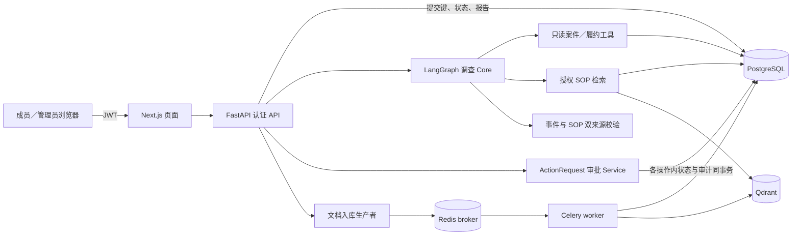

# Project A｜订单履约异常调查与受控处置 Agent

这是 RAGForge AI 仓库中的 Project A。面向多企业订单履约异常，Agent 只读查询案件和履约事实、检索授权 SOP，并生成带来源引用的调查报告。成员需要处置时另行创建申请；**管理员审核批准后，仍须另行显式执行，系统才创建站内通知记录**。报告不自动触发处置，站内记录不代表邮件、短信已发送或客户已收到。

项目针对的是多来源事实难以核对、模型可能把线索误判为原因、跨企业知识可能越权进入报告，以及处置缺少人工把关与重复执行防线等问题。这里展示的是合成数据与隔离环境中的实现和验收，不声称已有生产用户或量化业务收益。

## 使用流程

`登录／选择企业 → 提交调查 → 等待或刷新找回状态 → 阅读报告与证据 → 手动创建处置申请 → 管理员批准或拒绝 → 对已批准申请显式执行 → 查看站内通知`

调查与处置由人选择案件衔接。批准只改变申请状态，执行才创建系统内通知记录。

## 核心能力与存档结果

以下结果分别属于注明的日期、版本和环境；不跨版本相加为通过率。〔离线〕表示受控 Provider 回放，〔隔离〕表示真实隔离数据库／检索或认证链路，〔真实模型·单次〕表示本机聊天模型的一次运行。

| 能力 | 机制与已验证范围 |
| --- | --- |
| **LangGraph Agent 编排** | 验证了模型决策、工具校验与执行、报告校验在实际 Graph 节点中衔接，阶段门槛、来源校验、预算和纠错仍生效。2026-10-19 当时版本的 **11 组受控 Provider 离线回放**与旧循环对照，并非当前版本的完整等价回归；另有当前 Graph 的真实页面调查收到经校验的六部分报告〔真实模型·单次〕。[脱敏摘要](docs/PROJECT_A_BASELINE_EVIDENCE.md) |
| **证据约束的限定归因** | 验证了业务事件与 SOP 来源分别校验，SOP 不代替订单事实。2026-10-21 合成订单的单次真实 Graph/API 调查仅确认“该运单发货延迟与库存分配受阻有关”，整单其他原因及完成情况保持未知，建议未执行；React 展示另用保存响应回放验收，不能合称实时浏览器到模型链路。[脱敏摘要](docs/PROJECT_A_BASELINE_EVIDENCE.md) |
| **SOP 检索与权限隔离** | 2026-10-19 C10 在 Graph 迁移前，以隔离 PG／Qdrant／Embedding 和受控聊天 Provider 验证：跨工作区正文、chunk 与来源 ID 未进入模型上下文，越权请求在检索前被拒绝。源码实现向量检索、工作区内 PG/BM25 稀疏检索及 RRF 融合；排序效果未做专项运行评测。[脱敏摘要](docs/PROJECT_A_BASELINE_EVIDENCE.md) |
| **审批事务与幂等** | 隔离 PostgreSQL 定向测试通过，验证企业范围幂等键的唯一约束、并发同键去重、审核与执行的行锁及审计事务回滚；真实 JWT/HTTP 链路验证创建、批准和拒绝。批准不会自动执行处置〔隔离〕。[脱敏摘要](docs/PROJECT_A_BASELINE_EVIDENCE.md) |
| **Celery＋Redis 文档入库** | 2026-10-19 隔离 Redis／PG／Qdrant 验证入库成功、受控失败及已完成 job 重复投递：重复后 chunk、vector、usage 未增加；失败的 document/job 和 Celery 任务分别记录失败。未验证多 worker 竞争或通用 exactly-once〔隔离〕。[脱敏摘要](docs/PROJECT_A_BASELINE_EVIDENCE.md) |
| **调查记录与刷新恢复** | 2026-10-22 隔离 PostgreSQL 专项验证提交占位独立可读、同键并发去重、报告校验后持久化及授权历史读取；受控 Provider＋真实 JWT/API＋隔离 PG 页面验收分别确认运行中刷新找回状态、完成后刷新找回报告。不是新增真实聊天模型验收〔隔离〕。[脱敏摘要](docs/PROJECT_A_INVESTIGATION_RUN_ACCEPTANCE.md) |

## 架构

## 技术栈与演示

主要技术：Python、FastAPI、LangGraph、PostgreSQL、Qdrant、Redis、Celery、Next.js。2026-10-22 核对的本地配置为 **Ollama `llama3.1:8b`** 聊天模型、**`nomic-embed-text`** Embedding（768 维），`RERANK_PROVIDER=none`；本地配置可能与其他部署不同。`docker-compose.yml` 定义 PostgreSQL、Redis、Qdrant、迁移、后端 API、Celery worker、前端、Prometheus 和 Grafana 服务；Ollama 在宿主机运行，不属于该 Compose 服务清单。

从新环境准备隔离数据与启动服务见[演示指南](docs/PROJECT_A_DEMO.md)。无需重新调用模型的[约三分钟分段演示](docs/PROJECT_A_3MIN_DEMO.md)依次展示历史真实结果的 React 回放、受控 Provider 的保存报告刷新读取，以及成员申请→管理员审核→显式执行后的站内记录。这三段使用不同的验证条件，不能合称一次实时浏览器到真实模型再到处置的端到端验收。

## 当前边界与后续计划

**当前边界**

- **耗时**：合成场景的一次真实调查约 491 秒，仅单次样本。
- **执行**：按单 API worker 验收；服务重启后遗留运行标记为“中断”，不续算，历史成功报告可按授权读取。
- **原因归因**：库存分配受阻仅在一次合成场景中验证；证据不足时保持“未知”。
- **通知**：仅创建站内记录，未接入邮件或短信。

**后续计划**

- 根据逐轮计时优化单次调查耗时
- 扩展有订单级关联证据的原因类型
- 建立区分首答与纠错结果的小型评测集

## 说明

原始运行文件仅本地保留，公开仓库提供[脱敏基线摘要](docs/PROJECT_A_BASELINE_EVIDENCE.md)和[调查记录验收摘要](docs/PROJECT_A_INVESTIGATION_RUN_ACCEPTANCE.md)；许可证为 [MIT](LICENSE)。
