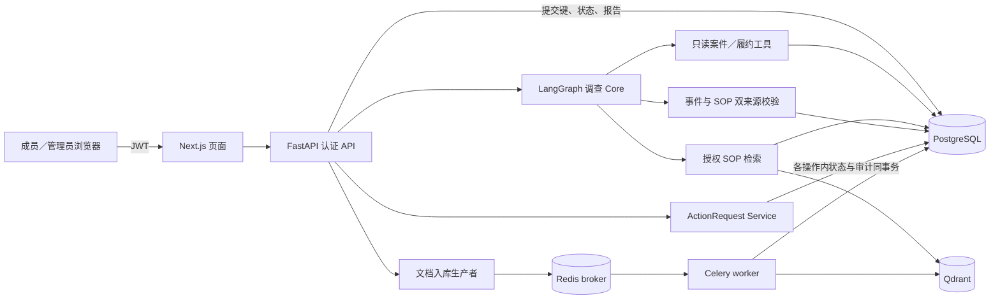

# Project A｜订单履约异常调查与受控处置

面向多企业的订单异常处理：成员登录并选择企业，提交订单案件调查；系统只读查询履约事实与授权 SOP，校验业务事件和知识来源后生成报告。成员据此**另行**创建客户通知申请，管理员人工审核；批准后仍须显式执行，系统才创建一条站内通知记录。报告不会自动触发处置，站内记录不代表邮件、短信已发送或客户已收到。

这是 [RAGForge AI](docs/ARCHITECTURE.md) 仓库中的 Project A 交付范围。首页只列当前可核实能力；运行条件、历史试验与失败记录分别见[演示指南](docs/PROJECT_A_DEMO.md)、[脱敏证据](docs/PROJECT_A_BASELINE_EVIDENCE.md)和[施工交接](docs/PROJECT_A_CONTINUATION.md)。

## 用户流程

`登录／选择企业 → 提交调查 → 等待或刷新找回状态 → 阅读报告与证据 → 创建处置申请 → 管理员批准或拒绝 → 对已批准申请显式执行 → 查看站内通知`

调查与处置靠人工选择案件衔接；批准只改变申请状态，执行才写入站内记录。调查记录按企业、申请人和提交键去重；成功报告保存后，可在授权范围内重新读取。服务重启不会从 Graph 中间节点续算，旧运行会转为中断状态。

## 架构



## 已验证能力

| 能力 | 已有验证与边界 |
| --- | --- |
| **LangGraph Agent 编排** | 决策、工具校验／执行、报告校验为实际节点；11 组受控 Provider 离线对照旧循环。一次当前 Graph 的真实页面调查收到四条业务事件与一条 SOP 来源的六部分报告；不代表 C01–C12 全矩阵。见[基线摘要](docs/PROJECT_A_BASELINE_EVIDENCE.md)。 |
| **SOP RAG 与企业权限** | 工作区授权后进行向量／关键词混合检索；C10 隔离 PG、Qdrant 与受控聊天 Provider 验证跨工作区正文、chunk、来源 ID 不进入模型上下文。已存档本地检索未验证学习型 Rerank。见[基线摘要](docs/PROJECT_A_BASELINE_EVIDENCE.md)。 |
| **证据约束的限定归因** | 合成订单的单次真实 Graph/API 调查以六条业务事件和独立 SOP 来源，限定确认“该运单发货延迟与库存分配受阻有关”；整单完成及其他原因未知，建议未执行。该次耗时 **490.797 秒**，不构成稳定率或性能结论。React 页面另以保存响应回放验证展示、展开、复制和退出加载。见[基线摘要](docs/PROJECT_A_BASELINE_EVIDENCE.md)。 |
| **审批事务与幂等** | 企业范围的申请键由数据库唯一约束兜底，审核／执行阻止重复决定或重复站内记录；状态与审计同事务。最终 21 项隔离 PG 定向测试及真实 JWT/HTTP 链路有存档；批准不等于执行。见[基线摘要](docs/PROJECT_A_BASELINE_EVIDENCE.md)。 |
| **Celery＋Redis 文档入库** | 隔离 Redis worker、PG、Qdrant 中验证一项成功、一项受控失败及已完成 job 的重复投递；重复后 chunk／vector／usage 未增加。未验证多 worker 竞争或通用 exactly-once。见[基线摘要](docs/PROJECT_A_BASELINE_EVIDENCE.md)。 |
| **调查记录与刷新恢复** | 0009 迁移、提交占位、同键并发去重、截止／失败终态和已校验报告保存；隔离 PG 专项 6 项通过。两轮**受控 Provider＋真实 JWT/API＋隔离 PG** 页面验收分别确认运行中刷新找回状态、完成后刷新找回报告；各轮一条记录、一份报告、两次受控 Provider 调用。它们不是新的真实聊天模型验收。见[脱敏摘要](docs/PROJECT_A_INVESTIGATION_RUN_ACCEPTANCE.md)。 |

## 启动与演示

推荐在 Windows 普通 PowerShell 使用[隔离演示指南](docs/PROJECT_A_DEMO.md#从新环境准备隔离演示)：准备 Python 3.12／Node.js、现有依赖、PostgreSQL／Redis／Qdrant 与本机 Ollama 模型；先建立空的 `ragforge_day6_test`。随后运行既有入口：

```powershell
# 在已检出的仓库根目录执行；先完成下方链接中的依赖与隔离库准备
powershell -NoProfile -ExecutionPolicy Bypass -File .\scripts\start_investigation_allocation_demo.ps1
```

脚本仅针对受保护的隔离库准备身份、迁移、合成案件及独立 SOP collection，成功时打印页面、案件、工作区和分析时点。**不要把曾经运行的本地端口当作永久服务**：演示前重新检查 `READY` 与本机资源；不要把脚本指向业务数据库。

无需重新调用模型的展示分为三条路径：[约三分钟录屏脚本](docs/PROJECT_A_3MIN_DEMO.md)逐步说明 **历史真实结果的 React 保存响应回放**、**受控 Provider 的数据库报告刷新恢复**、以及**同一隔离企业的申请→审核→站内通知**。这些是分段证据，不能合称一次实时浏览器到真实模型再到处置的 E2E。需要真实调查时，使用上面的隔离 3110 页面单次提交；耗时与模型可用性依赖本机环境。

## 限制

- 当前调查执行只按**单 API worker**验收；无 Graph 持久化检查点、断点续算或调查到处置的自动衔接。
- 490.797 秒是一次合成场景真实调查的耗时；尚无重复运行稳定率或性能改进结论。不能为缩短等待放宽证据与权限校验。
- 站内通知 `not_sent` 不表示外部送达；没有邮件／短信服务或客户收悉证明。
- C01–C12 当前 Graph 全矩阵、多 worker 入库竞争、通用并发限流与生产案件根因覆盖均未验收。完整施工记录见[交接](docs/PROJECT_A_CONTINUATION.md)。

本仓库另含通用 RAG SaaS 组件；其部署与监控配置见[系统架构](docs/ARCHITECTURE.md)。本页的验收结论只适用于上表注明的日期、版本和环境。许可证见[MIT](LICENSE)。
